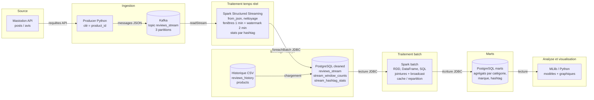

# 5SPAR - Projet de construction d'une architecture Spark end-to-end pour les données Mastodon
## Auteur : Julien RENOULT - Béatrice BEAVOGUI
## Promo : SUPINFO Programme Grande École 5ème année
### *Spécialité : Ingénierie Data*
### *Date : 03/10/2026*
### Lien Projet : ...

# Introduction

Dans le cadre de ce projet, nous devions construire une architecture Spark de bout en bout 
pour capturer des données en streaming avec l'[API Mastodon](https://docs.joinmastodon.org/client/intro/).

Pour réaliser ce projet, plusieurs technologies devront être utilisées :
- **Kafka** : pour la capture en temps réel des données
- **Spark** : pour traiter les données en streaming et en batch avec la possibilité de faire du machiner learning
- **PostgreSQL** : pour stocker les données de streaming traitées pour l'historisation
- **Python** : pour l'utilisation de Spark dans ses différentes couches (streaming, etc) et création de visualisations graphiques

Pour chaque dossier du projet contiendra un README.md détaillé sur comment est utilisé la technologie concernée, 
les commandes à utiliser pour faire telle action et l'explication en générale de comment est construit la fonctionnalité


## ⚙️ Pré-requis

Avant de lancer le projet, veuillez vérifier que vous avez bien installé :

* Docker
* Docker Compose

---

## 🛠️ Lancer le projet

Deux docker compose sont disponibles pour lancer les conteneurs.

### Development Environment

Commencer l'application :

```bash
docker compose -f docker-compose-dev.yml up --build
```

Arrête l'application :

```bash
docker compose -f docker-compose-dev.yml down
```

### Production Environment

Commencer l'application :

```bash
docker compose -f docker-compose-prod.yml up --build
```

Arrêter l'application :

```bash
docker compose -f docker-compose-prod.yml down
```

---


# Schéma du pipeline (à modifier)



## Légende

| Étape | Rôle |
| --- | --- |
| **Mastodon API** | Source des messages (avis et hashtags) |
| **Producer** | Publie chaque message dans Kafka, avec `product_id` comme clé |
| **Kafka** | Tampon distribué, partitionné, avec offsets |
| **Spark Streaming** | Parse le JSON, filtre, agrège par fenêtre et par hashtag |
| **PostgreSQL (cleaned)** | Données propres, flux temps réel et historique |
| **Spark batch** | Jointures, agrégations lourdes, optimisation |
| **PostgreSQL (marts)** | Tables d'agrégats prêtes pour l'analyse |
| **MLlib / Python** | Modèles et visualisations finales |

