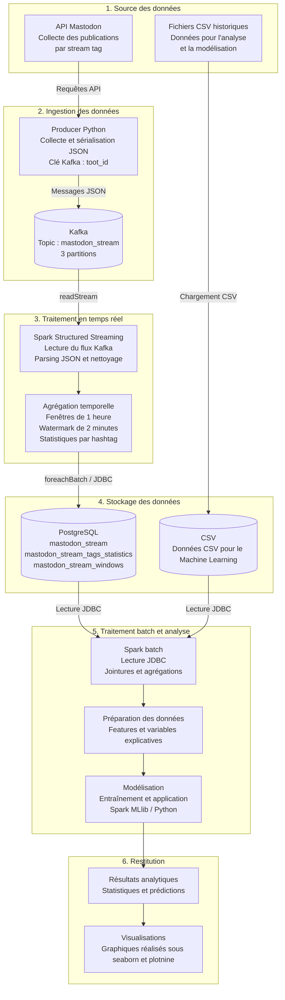

# 5SPAR - Projet de construction d'une architecture Spark end-to-end pour les données Mastodon
## Auteur : Julien RENOULT - Béatrice BEAVOGUI
## Promo : SUPINFO Programme Grande École 5ème année
### *Spécialité : Ingénierie Data*
### *Date : 03/10/2026-10/10/2026*
### Lien Projet : https://github.com/julien-data-analyst/5SPAR-streaming-spark

# Introduction

Dans le cadre de ce projet, nous devions construire une architecture Spark de bout en bout 
pour capturer des données en streaming avec l'[API Mastodon](https://docs.joinmastodon.org/client/intro/).

Pour réaliser ce projet, plusieurs technologies devront être utilisées :
- **Kafka** : pour la capture en temps réel des données
- **Spark** : pour traiter les données en streaming et en batch avec la possibilité de faire du machiner learning
- **PostgreSQL** : pour stocker les données de streaming traitées pour l'historisation
- **Python** : pour l'utilisation de Spark dans ses différentes couches (streaming, etc) et création de visualisations graphiques

Pour chaque dossier du projet contiendra un README.md détaillé sur comment est utilisé la technologie concernée, 
les commandes à utiliser pour faire telle action et l'explication en générale de comment est construit la fonctionnalité


## ⚙️ Pré-requis

Avant de lancer le projet, veuillez vérifier que vous avez bien installé :

* Docker
* Docker Compose

---

## 🛠️ Lancer le projet

Deux docker compose sont disponibles pour lancer les conteneurs.

### Development Environment

Commencer l'application :

```bash
docker compose -f docker-compose-dev.yml up --build
```

Arrête l'application :

```bash
docker compose -f docker-compose-dev.yml down
```

Attention dans la version dev, il faudra lancer manuellement le spark streaming, la création du topic, le producer en mode backfill et streaming :

#### Créer le topic Kafka 

```bash

docker compose -f docker-compose-dev.yml exec kafka \
  /opt/kafka/bin/kafka-topics.sh \
  --bootstrap-server kafka:9092 \
  --create \
  --if-not-exists \
  --topic "${KAFKA_TOPIC:-mastodon_stream}" \
  --partitions "${KAFKA_PARTITIONS:-1}" \
  --replication-factor "${KAFKA_REPLICATION_FACTOR:-1}"

```

Pour vérifier s'il a bien été créé :

```bash

docker compose -f docker-compose-dev.yml exec kafka \
  /opt/kafka/bin/kafka-topics.sh \
  --bootstrap-server kafka:9092 \
  --list
```

#### Lancer le producer mastodon

En mode streaming : 

```bash

docker compose -f docker-compose-dev.yml exec producer \
  python -m scripts.main --mode stream
```

En mode backfill :

```bash
docker compose -f docker-compose-prod.yml exec producer \
  python -m scripts.main --mode backfill

```

#### Lancer le spark streaming 

```bash

docker compose -f docker-compose-dev.yml exec streaming \
  python -m scripts.01_streaming_script
```

### Production Environment

Commencer l'application :

```bash
docker compose -f docker-compose-prod.yml up --build
```

Arrêter l'application :

```bash
docker compose -f docker-compose-prod.yml down
```

---

# Ordre d'exécution des notebooks

Les notebooks du projet doivent être exécutés dans l'ordre suivant afin de vérifier d'abord l'environnement, 
puis de réaliser les différents traitements batch avec la création, l'application du modèle créé.

Pour accéder aux notebooks, veuillez cliquer sur l'addresse suivante :

http://localhost:8081/


## Ordre recommandé

```text
00_environnement.py
        │
        │ Vérification de Spark, Kafka,
        │ PostgreSQL et Python Worker
        ▼
02_batch_toots.py
        │
        │ Agrégations statistiques
        │ sur les messages Mastodon
        │
        ├── day_of_week_tweets
        ├── month_tweets
        ├── jobs_tweets_mastodon
        ├── month_offer
        └── stream_tag_nb_tweets
        │
        ▼
02_batch_tags.py
        │
        │ Analyse des stream tags
        │ et des tags associés
        │
        ├── tag_stream_nb_tweets
        ├── tag_couple_tweets
        ├── tag_stream_jobs
        └── steam_tag_nb_users
        │
        ▼
02_batch_user_activity.py
        │
        │ Analyse des activités des utilisateur
        │ associés à leurs tweets
        │
        │
        ▼
03_MLlib_sentiment.py
        │
        │ Construction du modèle 
        │ et des tags associés
        │
        ├── mastodon_tweets_sentiment
        │
        ▼
PostgreSQL
Tables analytiques
```

# Schéma du pipeline

## Présentation générale

Le pipeline de traitement des données Mastodon repose sur une architecture combinant ingestion, 
traitement distribué en temps réel, stockage relationnel et analyse batch.

Les messages sont collectés depuis l'API Mastodon par un producteur Python, 
puis envoyés au format JSON dans un topic Kafka, avec le `toot_id` comme clé de message. 

Kafka assure la transmission, la conservation des données entre le producteur et le traitement temps réel de spark.

Spark Structured Streaming consomme ensuite les messages, extrait les données JSON, 
effectue leur nettoyage et calcule des statistiques sur les hashtags. Le traitement utilise des fenêtres temporelles d'une heure et un watermark de deux minutes pour gérer les retards d'arrivée des données. Les résultats sont écrits dans PostgreSQL via JDBC, notamment au moyen de `foreachBatch`.

En parallèle, des données CSV ont été téléchargées sur 
(Kaggle)[https://www.kaggle.com/datasets/krishbaisoya/tweets-sentiment-analysis?select=train_data.csv]
spécifiquement pour l'entraînement d'un modèle d'analyse de sentiment.

## Architecture du pipeline



## ⚠️ Spark Structured Streaming : backfill historique et retard de consommation Kafka

### 1. Contexte du problème

Le pipeline utilise Apache Kafka comme source de données et Spark Structured Streaming pour traiter les messages du topic `mastodon_stream`.

Le topic contient deux catégories de messages :
- Les publications historiques injectées lors du backfill.
- Les nouvelles publications reçues en temps réel.

Ces deux flux sont stockés dans le même topic Kafka.

La lecture Kafka est configurée avec les paramètres suivants :

\```python
.option("startingOffsets", "earliest")
.option("maxOffsetsPerTrigger", 500)
\```

Certaines requêtes de streaming utilisent également un déclenchement périodique :

\```python
.trigger(processingTime="10 seconds")
\```

Lorsqu'une requête démarre sans checkpoint existant, `startingOffsets = earliest`
lui permet de commencer à lire depuis le plus ancien offset disponible dans Kafka.
Lorsqu'un checkpoint existe, Spark reprend normalement à partir de la progression
enregistrée dans ce checkpoint.

Si Spark traite les messages moins rapidement que Kafka n'en reçoit, le retard
de consommation augmente. Les messages en temps réel restent alors dans Kafka
en attendant leur traitement. Cela peut-être provoqué à cause du backfill.

Il faudra donc attendre un peu avant de pouvoir observer les données en temps réelS.

Les symptômes observés dans les logs sont notamment :

- `numInputRows` limité à 500 lignes par micro-batch.
- Un décalage entre `endOffset` et `latestOffset`.
- Des messages `Streaming query has been idle and waiting for new data more than 10000 ms`.
- Des messages `StateStore ... Unloaded` lors de la gestion de l'état des agrégations.

Ces messages ne signifient pas nécessairement que Spark est bloqué.
Ils doivent être interprétés avec les offsets Kafka et les métriques de progression
de chaque requête.

### 3. Exemple de progression observée

Un premier relevé a fourni les valeurs suivantes :

| Indicateur | Première mesure |
|---|---:|
| Batch ID | 7 |
| Nombre de lignes traitées | 500 |
| Durée du batch | 1 136 ms |
| Start offset | 3 040 |
| End offset | 3 540 |
| Latest offset | 5 818 |
| Retard estimé | 2 278 offsets |

Un relevé ultérieur a fourni :

| Indicateur | Deuxième mesure |
|---|---:|
| Batch ID | 8 |
| Nombre de lignes traitées | 500 |
| Durée du batch | 1 282 ms |
| Start offset | 3 540 |
| End offset | 4 040 |
| Latest offset | 5 818 |
| Retard estimé | 1 778 offsets |

Le retard est passé de 2 278 à 1 778 offsets.

Cela montre que Spark a progressé dans Kafka pendant cette période, alors que
le dernier offset disponible est resté stable.

Ce qui est logique car il a très peu de nouvelles données entrantes capturées dans le mode
streaming du `producer`.

On peut rester sur cette situation mais il faudra regarder les logs de spark afin de voir 
au niveau des offsets où est-ce qu'il en est.

```bash
docker compose -f docker-compose-dev.yml logs -f spark
```